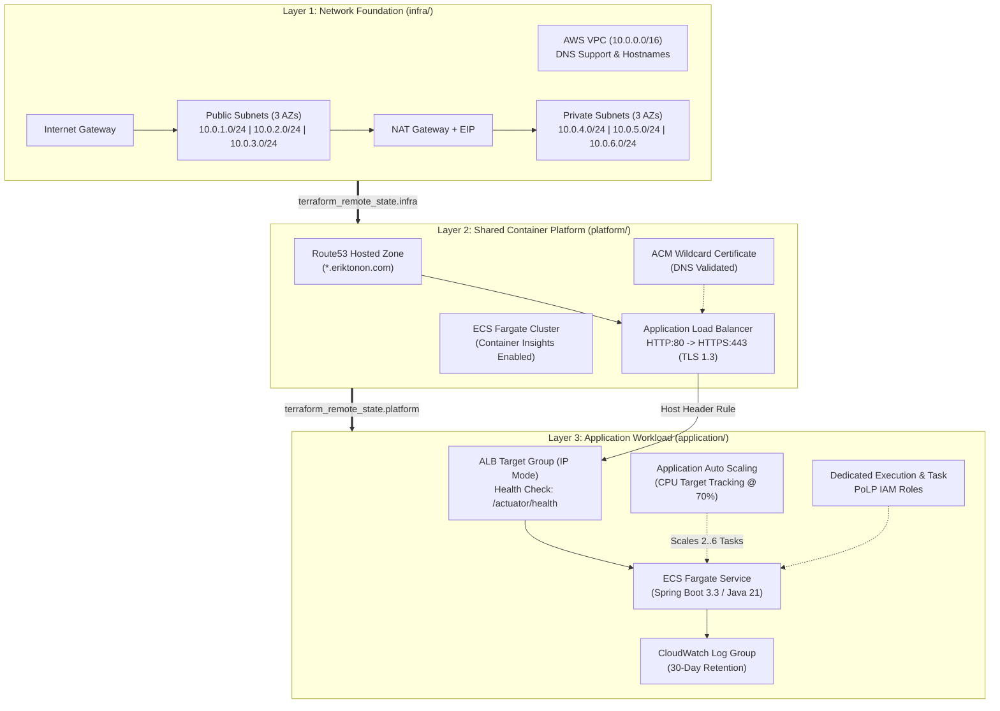

# AWS ECS Fargate 3-Layer Reference Architecture (Terraform + Spring Boot 3)

[](https://www.terraform.io/)
[](https://registry.terraform.io/providers/hashicorp/aws/latest)
[](https://adoptium.net/)
[](https://spring.io/projects/spring-boot)
[](./LICENSE)

Production-grade **3-Layer Infrastructure-as-Code (IaC)** architecture for running containerized **Spring Boot 3 (Java 21 LTS)** microservices on **AWS ECS Fargate**, featuring state isolation via S3 Remote State, TLS 1.3 Application Load Balancing, automated Route53 + ACM DNS validation, Principle of Least Privilege (PoLP) IAM roles, and Target Tracking Auto Scaling.

---

## Architecture Overview

The repository decouples infrastructure lifecycle into three independent Terraform state layers (`infra` -> `platform` -> `application`) linked via `terraform_remote_state`:



---

## Key Security & Reliability Highlights

- **3-Tier State Isolation**: Network changes (`infra/`), cluster/ALB governance (`platform/`), and microservice deployments (`application/infrastructure/`) maintain isolated S3 state files (`PROD/infra.tfstate`, `PROD/platform.tfstate`, `PROD/springbootapp.tfstate`) to minimize blast radius.
- **Zero-Trust Network & TLS 1.3**:
  - ALB enforces **`ELBSecurityPolicy-TLS13-1-2-2021-06`** on port `443` with automatic `HTTP_301` redirect from port `80` and `drop_invalid_header_fields = true`.
  - No public SSH (`port 22`) exposed on ECS Security Groups; interactive debugging relies on **AWS ECS Exec** (`enable_execute_command = true`) over AWS Systems Manager Session Manager.
- **Principle of Least Privilege (PoLP) IAM**:
  - Strictly separates the **ECS Task Execution Role** (`AmazonECSTaskExecutionRolePolicy` for pulling ECR images and emitting startup logs) from the **Application Task Role** (scoped exclusively to its CloudWatch Log Group and SSM Session Manager channels).
- **Hardened Container Runtime**:
  - Multi-stage `Dockerfile` using `eclipse-temurin:21-jdk-alpine` for compilation and `eclipse-temurin:21-jre-alpine` for runtime.
  - Executes as an unprivileged user (`appuser:appgroup`, UID `10001`), configured with container-aware JVM flags (`-XX:+UseContainerSupport -XX:MaxRAMPercentage=75.0`) and native `HEALTHCHECK` against `/actuator/health`.

---

## Repository Structure

```text
terraform-aws-ecs/
├── .github/workflows/
│   └── ci.yml                        # Automated Terraform fmt & validate pipeline
├── infra/                            # Layer 1: Multi-AZ VPC, Subnets, IGW & NAT Gateway
│   ├── development.tfvars
│   ├── infra-prod.config
│   ├── outputs.tf
│   ├── production.tfvars
│   ├── variables.tf
│   ├── versions.tf
│   ├── vpc.tf
│   └── README.md
├── platform/                         # Layer 2: ECS Fargate Cluster, ALB (TLS 1.3), ACM & Route53
│   ├── domain.tf
│   ├── ecs.tf
│   ├── outputs.tf
│   ├── platform-prod.config
│   ├── production.tfvars
│   ├── security-groups.tf
│   ├── variables.tf
│   ├── versions.tf
│   └── README.md
└── application/                      # Layer 3: Spring Boot 3.3 (Java 21) App & ECS Service IaC
    ├── infrastructure/
    │   ├── app-prod.config
    │   ├── app.tf
    │   ├── deploy.sh
    │   ├── Dockerfile
    │   ├── production.tfvars
    │   ├── task_definition.json
    │   ├── variables.tf
    │   └── versions.tf
    ├── src/
    └── pom.xml
```

---

## Step-by-Step Provisioning Guide

### Prerequisites

- **Terraform** `>= 1.6.0`
- **AWS CLI** v2 configured with appropriate credentials
- **Java 21** & **Docker** (for building the application image)
- An existing S3 bucket for Terraform remote state

### 1. Provision Layer 1 — Network Foundation (`infra/`)

```bash
cd infra
terraform init -backend-config="infra-prod.config"
terraform plan -var-file="production.tfvars"
terraform apply -var-file="production.tfvars"
```

### 2. Provision Layer 2 — ECS Cluster & ALB (`platform/`)

```bash
cd ../platform
terraform init -backend-config="platform-prod.config"
terraform plan -var-file="production.tfvars"
terraform apply -var-file="production.tfvars"
```

### 3. Build, Push & Deploy Layer 3 — Application (`application/`)

```bash
cd ../application/infrastructure
export AWS_ACCOUNT_ID="$(aws sts get-caller-identity --query Account --output text)"
export SERVICE_TAG="1.0.0"

sh deploy.sh build
sh deploy.sh dockerize
sh deploy.sh plan
sh deploy.sh deploy
```

---

## Author

**Erik Tonon** — Cloud & Platform Architect / SRE  
Website: [eriktonon.com](https://eriktonon.com)
